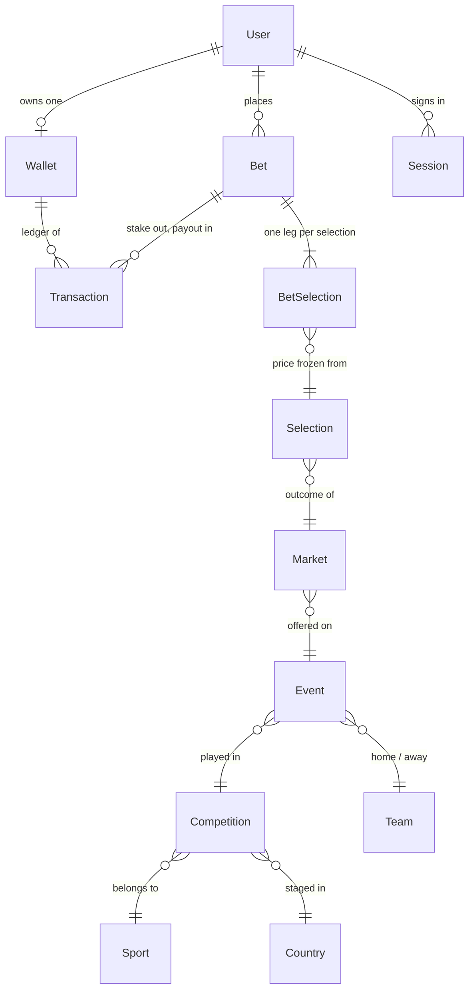

# SportGo — database

`prisma/schema.prisma` is the **deployment target, not the running data source**.
Every screen in this build is served by the simulated provider in `src/data`
through `src/services/**`. No query is issued, no connection is opened, and the
app runs with no database present. `src/server/db.ts` exists so that the seam is
already in the right place; it constructs the client on first use, never at
import.

---

## Entity overview

The core betting path — identity, catalogue, wager, ledger:



Around that core sit the account tables (`payment_methods`,
`payment_instruments`, `promotions`, `promotion_claims`, `notifications`,
`favorites`), the compliance tables (`rg_limits`, `self_exclusions`,
`kyc_records`, `audit_logs`) and one infrastructure table
(`rate_limit_counters`).

---

## Money is `Decimal(18, 3)`, never a float

The Tunisian dinar has three minor digits — 1 TND = 1000 millimes — so amounts
land on thousandths. IEEE-754 cannot represent 0.001, 0.1 or 0.7 exactly, so a
`double precision` ledger accumulates error on every arithmetic step: after a
few thousand stakes and payouts the sum of the entries no longer equals the
balance, and there is no way to tell rounding drift from a genuine
discrepancy. `numeric(18, 3)` is exact at the currency's own precision, and 18
digits leaves headroom no real balance will approach.

Odds are `Decimal(10, 3)` for the same reason: a price of `1.833` has to survive
the trip from feed to bet slip to settlement unchanged, because it is multiplied
into a payout the operator is contractually bound to.

The one deliberate exception is `Market.line` at `Decimal(6, 2)` — quarter-lines
(`-1.75`, `2.25`) need two decimals and nothing more, and comparing a line with
`=` after a float round-trip is how settlement disputes start.

---

## The ledger is append-only

`transactions` is the record of truth for money. Rows are inserted and their
`status` advances to a terminal state; **no row is ever rewritten**. A reversal
is a new, compensating entry, so the history of what happened is preserved
alongside the correction.

Each row carries `balanceAfter`, the wallet balance immediately after that
entry. This makes every row self-describing: an auditor can verify any point in
time without replaying the table from the beginning, and the whole balance can
be rebuilt from the ledger if the cache is ever lost.

`wallets.balance` is that cache. It exists so a page load is one row read rather
than an aggregate, and it is only ever written inside the same transaction that
appends the ledger row, under a row lock. A reconciliation job asserts
`wallets.balance = balanceAfter` of the newest completed transaction and alerts
on any divergence. **Balance is derived from the ledger; it is never mutated on
its own.**

`withdrawable` is not a column at all — it is
`balance - reserved - unmet bonus wagering`, computed on read so it can never
disagree with its inputs.

---

## Settling a bet

One transaction, wallet row locked first, every write behind that lock.
Parameters: `$1` user, `$2` payout, `$3` bet, `$4` stake to release, `$5` wallet
(from step 1), `$6`/`$7` the new ledger row's id and reference, `$8` the balance
step 3 returned.

```sql
BEGIN;

-- 1. Serialise on the wallet. Two settlements for the same user now queue
--    instead of interleaving and both reading a stale balance.
SELECT id
  FROM wallets
 WHERE "userId" = $1
   FOR UPDATE;

-- 2. Close the bet, but only if it is still open. Zero rows affected means a
--    concurrent worker already settled it: ROLLBACK and do nothing.
UPDATE bets
   SET status = 'won', payout = $2, "settledAt" = now()
 WHERE id = $3 AND status = 'pending';

-- 3. Move the cache and release the stake reserved at placement. The arithmetic
--    is Postgres' own, on the row we hold the lock on, so no value that went
--    through the application can be written back stale.
UPDATE wallets
   SET balance  = balance + $2,
       reserved = reserved - $4,
       version  = version + 1
 WHERE id = $5
RETURNING balance;

-- 4. Append the entry that explains the movement, stamped with the balance the
--    database actually arrived at.
INSERT INTO transactions
       (id, reference, "userId", "walletId", kind, status, amount,
        currency, "balanceAfter", "betId", "descriptionKey", "completedAt")
VALUES ($6, $7, $1, $5, 'bet_payout', 'completed', $2,
        'TND', $8, $3, 'wallet.tx.betPayout', now());

COMMIT;
```

In Prisma this is one `prisma.$transaction(async (tx) => { … })`, with step 1 as
a `tx.$queryRaw` because `FOR UPDATE` has no query-builder equivalent. Four
properties matter and all four come from the shape above:

- **Ordering.** The lock is taken before anything is read that will be written.
- **Idempotency.** Step 2's `AND status = 'pending'` is the guard; the affected
  row count decides whether the rest of the transaction runs. Placement has the
  same protection through `bets.idempotencyKey`.
- **Atomicity.** The bet's status, the cache and the ledger entry move together
  or not at all. A crash between steps leaves no half-settled bet.
- **Agreement.** Steps 3 and 4 could be written in either order — inside one
  transaction nothing observes the difference. Computing the balance in the
  database and reading it back with `RETURNING` is what guarantees the ledger
  records the balance that exists rather than one the application inferred.

Placement is the mirror image: lock the wallet, check the balance and the
responsible-gambling limits, insert the `bet_stake` entry (negative `amount`),
raise `reserved`, insert the bet and its legs with the odds frozen into
`bet_selections.oddsAtPlacement`.

---

## What is deliberately not stored

Data that is not collected cannot leak, cannot be subpoenaed and carries no
retention obligation. Three places in this schema are shaped by that:

| Table | Holds | Never holds |
|---|---|---|
| `sessions` | SHA-256 of the session token, hashed IP | the token, the raw IP |
| `payment_instruments` | PSP vault token, `•••• 4242`, last four, brand | PAN, CVV, IBAN, wallet PIN |
| `kyc_records` | provider, opaque case reference, decision, dates | documents, images, ID numbers, selfies |

Card details are typed into the provider's hosted fields and never reach this
application, which is what keeps SportGo out of PCI-DSS scope. Identity
documents stay inside the verification provider, which is built and audited to
hold them; SportGo keeps only the decision it needs in order to gate a
withdrawal. Passwords are stored as Argon2id hashes (bcrypt only as a fallback,
rehashed on next sign-in) and the plaintext never leaves the request handler
that receives it.

---

## Retention

- **Financial records** (`bets`, `bet_selections`, `transactions`,
  `promotion_claims`) — retained for the period the gambling regulator sets,
  typically five years from the transaction or from account closure. The
  foreign keys onto `users` are `Restrict` precisely so a user row cannot be
  deleted out from under them.
- **`audit_logs`** — append-only and retained on the same clock. The
  application's database role should hold `INSERT` and `SELECT` on this table
  and nothing else, so "append-only" is enforced by grants rather than by
  convention. PII is redacted before it is written: an entry records that an
  email changed, not what it changed to.
- **`kyc_records`** — the decision is retained with the financial records; the
  underlying artefacts are the provider's to expire under its own policy,
  because we never receive them.
- **`sessions`** — deleted once `expiresAt` has passed plus a short forensic
  window. **`rate_limit_counters`** — swept on `expiresAt`.
- **Erasure requests** — served by pseudonymising `users` (scrub the name,
  email, phone and date of birth; stamp `deletedAt`) while the retention-bound
  rows keep pointing at the now-anonymous id. A hard `DELETE` is neither
  possible nor lawful here.

---

## Before this runs against a real database

1. **Wire the connection.** Prisma 7 rejects `url` in the datasource block
   (P1012), so this is two steps: add `prisma.config.ts` reading `DATABASE_URL`
   for the CLI, then install a driver adapter (`@prisma/adapter-pg`) and pass it
   to the `new PrismaClient()` call in `src/server/db.ts`, which is written to be
   the only place that changes. Put a pooler (PgBouncer, transaction mode) in
   front of serverless runtimes.
2. **Migrations and seed.** Nothing in this repo has ever been migrated; the
   first `prisma migrate dev` generates the initial migration from this schema.
   The demo dataset in `src/data` is the natural seed source.
3. **Grants.** Separate roles for the app, the settlement worker and reporting.
   No `UPDATE` or `DELETE` on `audit_logs`; no `DELETE` on `transactions`.
4. **Reconciliation.** A scheduled job comparing `wallets.balance` against the
   ledger tail, alerting rather than self-correcting.
5. **Operations.** Encryption at rest, point-in-time recovery with rehearsed
   restores, and monthly partitioning of `transactions` and `audit_logs` once
   volume warrants it.
6. **Everything in `compliance.requiredBeforeLaunch`**
   (`src/config/app.config.ts`). A schema that can hold real bets is the
   smallest part of being allowed to take them.
