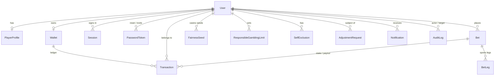

# SportGo — database

One Prisma schema, two engines:

| Environment | `DATABASE_URL` | Engine | Driver |
|---|---|---|---|
| Local development | `file:./dev.db` | SQLite (file in the project root, git-ignored) | `@prisma/adapter-libsql` |
| Production (Vercel) | `postgresql://…` | PostgreSQL | `@prisma/adapter-pg` (`pg`) |

Prisma fixes the `provider` at generate time, so `scripts/prisma-provider.mjs`
rewrites the single `provider = "…"` line in `prisma/schema.prisma` from the
scheme of `DATABASE_URL`. It runs automatically from `postinstall`, `build`,
`build:vercel` and every `db:*` script. Nothing else in the schema is
engine-specific — there are no `@db.*` native types — which is what lets one file
serve both.

The driver adapters are `require`d lazily in `src/server/db.ts`, so a Postgres
deployment never loads the libsql binding and vice versa. **SQLite is refused on
Vercel** (read-only, ephemeral filesystem would silently lose every account).

## Design decisions

- **Money is `BigInt` millimes** (1 TND = 1000). Not `Float` (drifts), not
  `Decimal` (does not exist on SQLite). An integer column behaves identically on
  both engines and sums exactly. The application works in integer millimes and
  converts to TND only at the UI edge (`src/lib/money.ts`).
- **Identifiers are application-generated cuids**, so a row can be referenced
  (a log line, an idempotency key) before it is inserted.
- **Roles are a column**, not a join table; the permission map is in code
  (`src/server/auth/permissions.ts`).
- **Ledger rows are never edited.** A correction is a new row referencing the
  original (`relatedId`).
- **Integrity lives in the database too.** Hand-written `integrity_guards`
  migrations add constraints and triggers that application code cannot bypass
  (below).

## Models

| Model | Purpose |
|---|---|
| `User` | Identity and account state: **username** (no e-mail, no phone), Argon2id hash, `role` (`PLAYER` / `MANAGER` / `SUPERADMIN`), `status`, `mustChangePassword`, `failedLoginCount`, `lockedUntil`, and `createdById` — the manager a player belongs to, or the superadmin a manager belongs to. |
| `PlayerProfile` | One per player: names, date of birth, locale, `kycStatus` (manual), `wageringBlocked`, `withdrawalsBlocked`, restriction reason. |
| `Session` | Server-side session: **HMAC of the token** (never the token), idle and absolute expiry, `revokedAt`, hashed IP, user agent. |
| `PasswordToken` | Single-use reset / invitation tokens (HMAC stored), with expiry and `usedAt`. |
| `Wallet` | One per user; `balance` in millimes, CHECK ≥ 0. |
| `Transaction` | The append-only ledger: `type` (incl. `CREDIT_TRANSFER`, a manager's side of selling credit; the player's side is a `DEPOSIT`), `status`, `amount`, `balanceBefore`/`balanceAfter`, `reference`, `idempotencyKey`, `betId`, `relatedId`, `createdById`. |
| `AdjustmentRequest` | Four-eyes approval queue for balance adjustments above the configured threshold. |
| `Bet` | A sportsbook ticket (`kind = SPORTS`) or a casino round (`kind = CASINO`, `gameKey`, `state`, `result` proof, optimistic-lock `version`). |
| `BetLeg` | Snapshot of each sportsbook selection at placement (event, market, label, price in milli-odds) — settlement never depends on the live dataset. |
| `FairnessSeed` | Per-player committed server seed (+ hash), client seed and nonce for casino rounds; revealed on rotation. |
| `SlotFreeSpins` | Server-held free-spin state for the slot. |
| `IdempotencyRecord` | Replayable response per `(userId, scope, key)` so a retried request returns the original outcome. |
| `ResponsibleGamblingLimit` | Deposit / stake / loss / single-bet limits with a pending value + effective time for cooling-off on increases. |
| `SelfExclusion` | Cooling-off and self-exclusion periods. |
| `AuditLog` | Immutable record of security- and money-relevant events (see below). |
| `Notification` | In-app notifications, stored as i18n keys + params, so they render in the reader's language. |
| `Favorite` | A player's favourites (model, service and API exist; there is no toggle in the UI yet). |
| `Setting` | Admin-editable runtime settings (JSON value); the registry in `src/server/settings/registry.ts` is the only source of valid keys. |
| `RateLimitCounter` | Fixed-window counters for the database-backed rate-limit policies. |



## Guarantees enforced by the database

Applied in `prisma/migrations/<engine>/20261007150000_integrity_guards`:

- `Wallet.balance >= 0`.
- Each `Transaction` satisfies `balanceAfter = balanceBefore + amount`.
- `Transaction` rejects UPDATE/DELETE, except a one-way `PENDING → final status`
  transition (how a withdrawal is approved or reversed).
- `AuditLog` rejects UPDATE/DELETE; on PostgreSQL TRUNCATE is blocked as well.

On top of that the application: debits with a guarded atomic
`updateMany(balance ≥ amount)`; makes every money movement idempotent through
unique `(userId, idempotencyKey)`; and can `reconcileWallet` — the balance must
equal the sum of all the user's ledger entries (a pending withdrawal already holds its funds, so it counts). The admin dashboard and
the player detail page surface that reconciliation.

**SQLite note:** an interactive transaction owns the only connection, so any read
made through the global client while one is open waits on a lock the caller holds
(Prisma error `P2028`). Code that runs inside `transact(tx => …)` must therefore
read through `tx` — including settings (`getSetting(key, tx)`). The integration
suite has a regression check for this.

## Migrations

Migrations are engine-specific SQL, so they live in separate folders and
`prisma.config.ts` picks the one that matches `DATABASE_URL`:

```
prisma/migrations/sqlite/      20261007145255_init, 20261007150000_integrity_guards, 20261008151318_managers_and_roles
prisma/migrations/postgresql/  20261007145255_init, 20261007150000_integrity_guards
```

When you change the schema, generate and review a migration **for both engines**
(`DATABASE_URL=file:./dev.db npm run db:migrate -- --name <change>`, then the same
with a PostgreSQL URL) and commit both folders. `prisma migrate deploy` (via
`npm run db:deploy`, and `build:vercel`) applies pending migrations and never
resets data.

## Commands

```bash
npm run db:deploy      # apply migrations to DATABASE_URL (safe, forward-only)
npm run db:seed        # create the superadmin (ADMIN_USERNAME / ADMIN_PASSWORD)
npm run db:migrate     # create a new migration in development
npm run db:studio      # browse data
npm run admin:recovery-link -- <username>   # break-glass single-use reset link (superadmin)
```

To reset a local database: stop the dev server, delete `dev.db*`, run
`npm run db:deploy && npm run db:seed`, and restart the server (it holds the file
and the generated client open).

## Verification status

The full integration suite (273 checks: auth, RBAC, manager scoping, the credit chain,
ledger, concurrency, withdrawals, four-eyes, casino rounds, page protection, audit, reports) passes
against SQLite on both the dev server and a production build, and against
PostgreSQL **using Prisma's embedded server (`prisma dev`, PGlite) with a
single-connection pool**. That validates the PostgreSQL migrations, triggers and
queries; it is not a load test of a networked, pooled PostgreSQL such as Neon or
Supabase, which you should still smoke-test once after provisioning.

## Scale notes

- Dashboard time series are bucketed in application memory from at most 250,000
  rows per query. Past that, use SQL `date_trunc` aggregation or a rollup table.
- `BigInt` columns are serialised as numbers of millimes at the API edge; balances
  beyond 2^53 millimes (9 × 10^12 TND) are out of scope.
